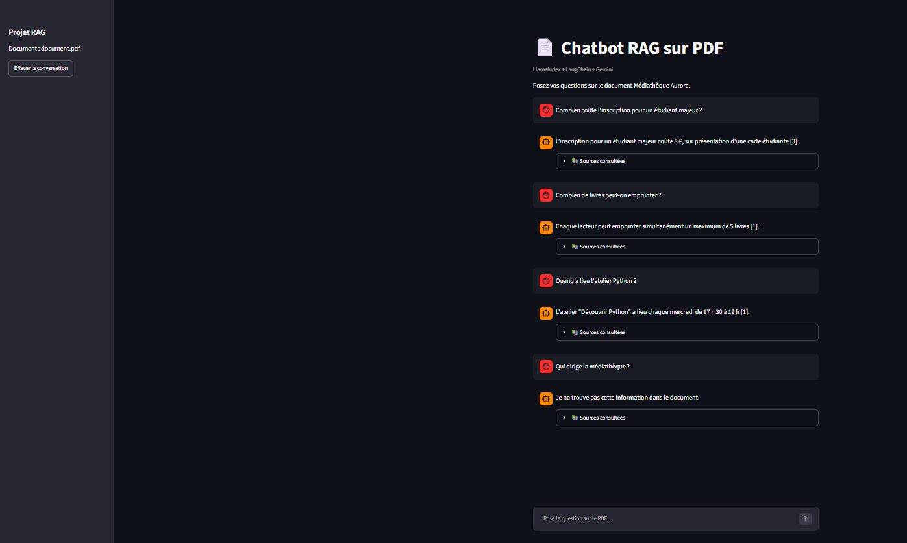
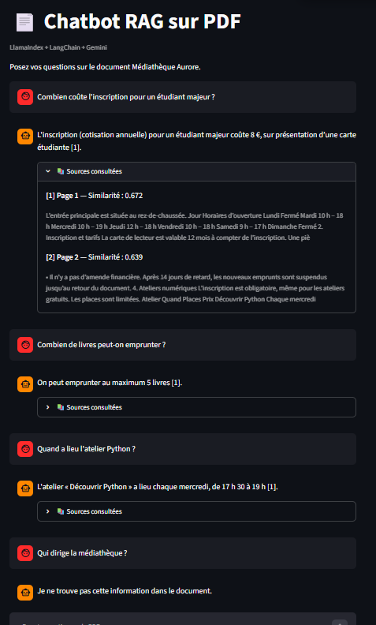
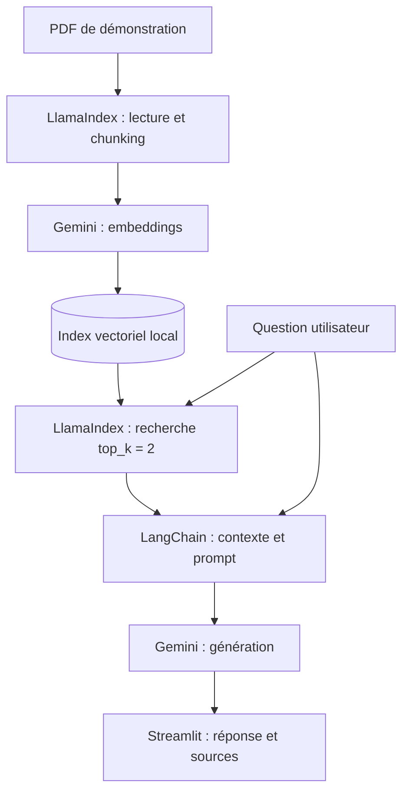

# Chatbot RAG sur PDF

> Mini-projet Python pour découvrir un pipeline **Retrieval-Augmented Generation (RAG)** avec **LlamaIndex**, **LangChain**, **Google Gemini** et **Streamlit**.

L'application répond en français aux questions portant sur un PDF de démonstration. Elle recherche d'abord des passages dans un index vectoriel local, puis transmet ces passages à un LLM pour générer une réponse citant ses sources. Si le document ne contient pas l'information, l'assistant est invité à le signaler.



<details>
<summary>Voir le détail des passages retrouvés</summary>



</details>

## Fonctionnalités

- Lecture et indexation d'un document PDF textuel avec **LlamaIndex**.
- Découpage du texte en chunks et génération d'embeddings via **Gemini**.
- Recherche sémantique des **2 passages les plus proches** de chaque question.
- Construction du prompt et appel au LLM avec **LangChain**.
- Réponse en français, références `[1]`, `[2]` et consultation des extraits et pages dans **Streamlit**.
- Historique des messages conservé pendant la session Streamlit.
- Scripts d'évaluation distincts pour la recherche et la génération.

## Architecture



Le PDF est **indexé une fois** avec `ingest.py`. Les questions suivantes réutilisent l'index enregistré dans `storage_256/`, sans recalculer les embeddings du document.

## Stack

| Composant | Technologie | Rôle |
|---|---|---|
| Langage | Python 3.11 | Développement |
| Ingestion et recherche | LlamaIndex | Lecture PDF, chunks, index et retrieval |
| Embeddings | `gemini-embedding-001` | Représentation vectorielle des passages et questions |
| Orchestration LLM | LangChain | Template de prompt et appel au modèle |
| Génération | `gemini-3.5-flash-lite` | Réponse fondée sur le contexte retrouvé |
| Interface | Streamlit | Chat, historique et détail des sources |
| Stockage | Index local LlamaIndex | Persistance du vecteur et des métadonnées |

L'API Gemini nécessite une clé Google AI Studio et peut être soumise à des quotas ou à des frais selon l'utilisation.

## Démarrage rapide — Windows / PowerShell

### 1. Récupérer le projet et préparer Python

```powershell
git clone https://github.com/VOTRE-UTILISATEUR/rag-pdf-chatbot.git
cd rag-pdf-chatbot
py -3.11 -m venv .venv
.\.venv\Scripts\Activate.ps1
python -m pip install -r requirements.txt
```

Remplacez `VOTRE-UTILISATEUR` par votre identifiant GitHub lorsque le dépôt sera publié.

### 2. Configurer la clé API

```powershell
Copy-Item .env.example .env
```

Ouvrir `.env` et renseigner la clé obtenue sur [Google AI Studio](https://aistudio.google.com/apikey) :

```dotenv
GOOGLE_API_KEY=votre_cle_api
```

**Ne jamais commiter `.env` :** ce fichier est ignoré par Git.

### 3. Construire l'index puis démarrer le chatbot

Le document de test est fourni dans `data/document.pdf` ; il est fictif et contient du texte sélectionnable.

```powershell
python ingest.py
python -m streamlit run app.py
```

Ouvrir **http://localhost:8501** si le navigateur ne s'ouvre pas automatiquement.

La configuration utilisée pour la version évaluée est : **`chunk_size=256`**, **`chunk_overlap=40`**, **`top_k=2`**, index **`storage_256/`**.

## Questions de démonstration

| Question | Réponse attendue |
|---|---|
| Combien coûte l'inscription pour un étudiant majeur ? | 8 € (sur présentation d'une carte étudiante) |
| Combien de livres peut-on emprunter ? | 5 livres |
| Quand a lieu l'atelier Python ? | Chaque mercredi de 17 h 30 à 19 h |
| Quel est le prix d'une impression noir et blanc ? | 0,10 € par page |
| Qui dirige la médiathèque ? | L'information n'est pas présente dans le document |

## Évaluation

### Recherche : effet du chunking

Un jeu de **5 questions factuelles** sert à vérifier si le chunk contenant une expression attendue est présent parmi les résultats de recherche.

| Métrique | Chunks de 512 tokens (3 chunks) | Chunks de 256 tokens (5 chunks) |
|---|---:|---:|
| Hit@1 | 80 % (4/5) | **100 % (5/5)** |
| Hit@2 | 80 % (4/5) | **100 % (5/5)** |
| Hit@3 | 100 % (5/5) | **100 % (5/5)** |

### Génération : tests fonctionnels

Le script teste **6 questions** (5 factuelles et 1 dont la réponse est absente) et vérifie la présence des éléments textuels attendus, ainsi que celle de références pour les réponses factuelles.

**Résultat observé : 6/6 tests réussis.**

```powershell
python evaluate.py storage_256
python evaluate_llm.py
```

**Limites des résultats :** ce jeu de tests est très petit et construit pour le PDF fourni. Les contrôles d'exactitude reposent sur des expressions régulières ; ils ne mesurent ni la robustesse générale du modèle, ni la fidélité sémantique réelle de chaque citation. Les scores de similarité ne sont pas des probabilités de vérité.

## Organisation du dépôt

```text
rag-pdf-chatbot/
├── assets/                 # Captures de démonstration
├── data/
│   └── document.pdf        # PDF fictif pour les tests
├── .env.example            # Modèle de configuration API
├── .gitignore
├── requirements.txt        # Dépendances figées
├── ingest.py               # Chargement PDF, chunks, embeddings et indexation
├── rag.py                  # Chatbot RAG en ligne de commande
├── app.py                  # Interface Streamlit
├── evaluate.py             # Évaluation du retrieval (Hit@K)
└── evaluate_llm.py         # Tests de génération et d'abstention
```

Les fichiers `.env`, `.venv/`, `storage/` et `storage_256/` sont locaux et exclus du versionnement.

## Limites de cette V1

- Le document interrogé est **fixe** : aucun chargement de PDF depuis l'interface.
- Le prototype utilise un **seul PDF** de démonstration.
- L'historique est visible dans Streamlit, mais **n'est pas transmis au LLM** : chaque question est indépendante.
- Le modèle est invité à citer ses sources, sans mécanisme supplémentaire de vérification automatique de leur exactitude.
- L'index local et le jeu de tests sont volontairement simples : ce projet est une **démonstration pédagogique**, pas un système de production.

## Pistes d'amélioration

- Import de plusieurs PDF depuis l'interface.
- Tests sur un corpus plus large, avec métriques de retrieval et d'ancrage documentaire plus robustes.
- Filtrage et reranking des résultats pour limiter les passages non pertinents.
- Éventuellement, ajout de **LangGraph** dans un projet agentique distinct.

---

*Projet d'apprentissage — Python, LlamaIndex, LangChain, Gemini et Streamlit.*
